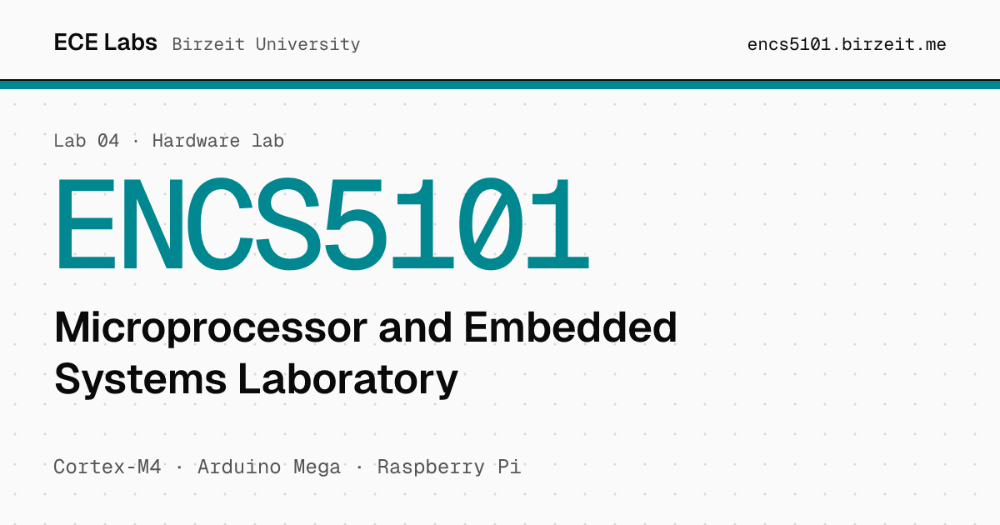

<a href="https://encs5101.birzeit.me"></a>

# ENCS5101 · Microprocessor and Embedded Systems Laboratory

Step-by-step lab manual for ENCS5101 at Birzeit University: ARM Cortex-M4 assembly in the Keil simulator, then the Arduino Mega from GPIO and motors to AVR assembly, timers, interrupts, ADC and serial links, finishing with LabVIEW, an elevator controller and the Raspberry Pi.

**[Open the manual](https://encs5101.birzeit.me)** · [PDF](https://encs5101.birzeit.me/ENCS5101-Manual.pdf) · [Setup guide](https://encs5101.birzeit.me/setup/) · [All labs](https://birzeit.me)

## Run it locally

Requires [Node.js](https://nodejs.org) 24 and npm.

```sh
git clone https://github.com/ECE-Birzeit/encs5101.git
cd encs5101
npm ci
npm run dev        # http://localhost:5173, reloads as you edit
```

```sh
npm run build      # outputs to .vitepress/dist, fails on dead links
npm run preview    # serve the built site
```

## Project layout

| Path | Contents |
|:--|:--|
| `index.md` | Home page |
| `setup/` | One page per tool (Keil, Arduino IDE, …) plus an overview |
| `experiments/` | One page per experiment, plus the index table |
| `snippets/exp<N>/` | Source included into pages with `<<< @/snippets/...` |
| `public/images/` | Figures and Keil screenshots taken from the department manual |
| `public/ENCS5101-Manual.pdf` | The department's ten experiment PDFs merged into one file |
| `.vitepress/config.mts` | Site config: nav, sidebar, search, link previews |

## Contributing

Found a mistake? Click **Edit this page on GitHub** at the bottom of any page, or [open an issue](https://github.com/ECE-Birzeit/encs5101/issues/new/choose). The [contributing guide](https://github.com/ECE-Birzeit/.github/blob/main/CONTRIBUTING.md) covers writing style and pull requests.

## Deployment

`.github/workflows/deploy.yml` builds and deploys to GitHub Pages on every push to `main`, so merged changes are live within a couple of minutes at [encs5101.birzeit.me](https://encs5101.birzeit.me).

## License

The written content is licensed under [CC BY 4.0](LICENSE): you may share and adapt it, including for your own course, as long as you credit the source. Code, meaning `snippets/` and the site code (`.vitepress/`, `.github/`), is licensed under [MIT](LICENSE-CODE). © 2026 [Mohammad Abu-Shelbaia](https://mabushelbaia.com).

Not covered by either license, and still owned by their authors:

- `public/ENCS5101-Manual.pdf`, the department's manual
- `public/images/`, figures taken from the department's manual

The Birzeit University name and logo are the university's; they are not licensed here. Screenshots of third-party software, and product names and logos, belong to their respective owners.

---

<sub>Part of [ECE Labs](https://birzeit.me) · Maintained by [Mohammad Abu-Shelbaia](https://mabushelbaia.com)</sub>
